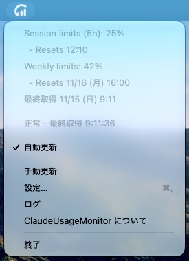

# ClaudeUsageMonitor

Claude のセッション使用率（5時間）・週次/月次使用率・リセット時刻を表示、JSON として出力、外部 API に送信できる macOS メニューバー常駐アプリ。
Individual（Pro / Max）、Enterprise の各プランに対応。

通常 Claude は、最新のセッション使用率などのメタ情報を直接参照することはできない。
そこで、このアプリが出力する JSON を参照させることで、例えば、

 - 現在のセッション使用率が 90% を超えたら作業を停止して。
 - 5時間制限が次回リセットされるまでスリープして、リセット後に作業を開始して。

のようなプロンプトが利用できるようになる。



## 主要機能

### メニューバー常駐・状態表示

- Dock には出ず、メニューバーにアイコンを常駐
- アイコンの色（Normal / Orange / Red）で最新の取得状態と使用率警告を判別
- メニューに使用率サマリ（セッション使用率・セッションリセット時刻・週次/月次使用率・リセット時刻）と最終取得時刻を常時表示

### モニタリング

- 設定した間隔で Claude の使用状況データを取得し、セッション使用率・週次/月次使用率・リセット時刻を取得
- （optional）取得データを JSON として任意のフォルダに保存
- （optional）取得データを設定した API エンドポイントに POST

### 使用率警告

- セッション使用率または週次/月次使用率が設定した警告閾値以上になるとメニューバーアイコンが Orange に変化
- Orange への遷移時に macOS のユーザー通知が発火

### 取得失敗の警告

- 使用状況を取得できない状態が、設定した許容回数だけ続くとメニューバーアイコンが Red に変化し、macOS のユーザー通知が発火
- 許容回数に達するまでは、アイコンは変えず、メニューの状態表示だけで途中経過を見せる

通知の ON / OFF は macOS の「システム設定 → 通知 → ClaudeUsageMonitor」から操作する。

## 動作環境

- macOS 26 以降
- ビルドおよびインストールには [Xcode](https://apps.apple.com/jp/app/xcode/id497799835?mt=12)（Command Line Tools のみでは不可）が必要
- [Claude Code CLI](https://docs.claude.com/en/docs/claude-code/overview) がインストール済みで、`claude` で `/usage` を実行すると使用率が表示されること。

## セットアップ

### 1. アプリ本体のインストール

- このリポジトリを `git clone` するか、[ZIP でダウンロード](https://github.com/hirokidoi/ClaudeUsageMonitor/archive/refs/heads/master.zip) して展開する。

- プロジェクトのルートディレクトリで以下のコマンドを実行するとビルドされ、`/Applications/ClaudeUsageMonitor.app` にアプリがインストールされる。
  ```
  make install
  ```

### 2. Claude Code CLI の確認

1. ターミナルで `claude` を起動し、ログイン済みであることを確認する
2. メニューの「設定…」から Claude タブを開く。`claude` がよくあるインストール先にあれば自動で見つかる。別の場所のものを使う場合は「Claude Code CLI のパス」で指定する
3. `CLAUDE_CONFIG_DIR` を設定して claude を使っている場合は、そのパスを Claude タブの「CLAUDE_CONFIG_DIR」に入れる。
4. 「接続テスト」の「テスト」を押し、`接続できました` と出ることを確認する
5. メニューから「手動更新」を選び、状態が `正常` に変われば成功

## 使い方

### メニュー項目

メニュー先頭には使用率サマリが常時表示される。取得前は `----` を表示する。サマリの次の行には、使用状況を最後に取得できた時刻（`最終取得 M/d (曜) H:mm`）が出る。

**Individual（Pro / Max）**

| 項目 | 説明 |
|------|------|
| `Session limits (5h): N%` | 現在のセッション使用率 |
| `  - Resets H:mm` | セッションのリセット時刻（JST） |
| `Weekly limits: N%` | 現在の週次使用率 |
| `  - Resets M/d (曜) H:mm` | 週次のリセット時刻（JST） |

**Enterprise**

| 項目 | 説明 |
|------|------|
| `Monthly limits: N%` | 現在の月次使用率 |
| `  - Resets M/d (曜) H:mm` | 月次のリセット時刻（JST） |

リセット時刻を過ぎた枠は、使用率が最新ではないので `----` になり、リセットの行は `  - Resets <時刻> (経過)` になる。
次の取得で値が更新されると元の表示に戻る。最終取得の行を見れば、表示中の値がどれだけ古いかを判断できる。

**操作項目（共通）**

| 項目 | 説明 |
|------|------|
| 状態の行 | 現在の状態を文言で表示 |
| 自動更新 | チェックが入っているとき、設定した間隔で自動取得する。外すと手動更新のみになる（起動直後の取得もしない） |
| 手動更新 | 即時データを取り直す（次回自動取得も手動更新時点から設定間隔後にリセットされる） |
| 設定… | 設定ウィンドウを開く（Cmd+, でも開ける） |
| ログ | 動作ログウィンドウを開く |
| ClaudeUsageMonitor について | バージョンとライセンスを表示 |
| 終了 | プロセス終了 |

## 状態表示

メニューバーアイコンは Normal / Orange / Red の 3 値

### Normal 条件（いずれか）
- 直近の取得が成功しており、セッション使用率・週次/月次使用率のいずれも警告閾値未満
- 起動直後で一度も取得を終えていない（状態の行は `取得待機中`）
- 取得に失敗しているが、許容回数に達しておらず、直近に取れた値も警告閾値未満（状態の行に途中経過が出る）

Normal 時のアイコンは macOS のメニューバー色に自動追従する。

### Orange 条件
- Red でなく、直近に取れた値のセッション使用率または週次/月次使用率のいずれかが**警告閾値以上**

Orange へ遷移した瞬間に macOS のユーザー通知（`Claude Usage Warning`）が 1 回だけ発火する。

### Red 条件と状態の文言

| 状態 | 文言 |
|------|------|
| 取得失敗が許容回数に達した | `異常 - 取得失敗 (n/m) - <理由>` |
| JSON ファイルの書き込みに失敗 | `異常 - 出力失敗 (JSON)` |
| API エンドポイントへの POST に失敗 | `異常 - 出力失敗 (API)` |

取得失敗の警告のときは、いつから取得できていないかが併せて表示される。ログインが切れている可能性があるときは、その案内も出る。

取得失敗が許容回数に達したときの通知（`Claude Usage Fetch Failed`）は、警告に入った瞬間に 1 回だけ発火する。

出力失敗は、保存先やエンドポイントを直すか変えると解消する。

### Red 以外の状態の文言

| 状態 | 文言 |
|------|------|
| 起動直後 | `取得待機中` |
| 取得成功 | `正常 - 最終取得 H:mm:ss` |
| 取得失敗（許容回数に達するまで） | `取得失敗 (n/m) - <理由>` |

n は失敗が続いている回数、m は許容回数。

### 取得失敗の理由

| 理由 | 意味 |
|------|------|
| `claude が見つかりません (設定の Claude タブで場所を指定)` | Claude Code CLI が見つからない |
| `CLAUDE_CONFIG_DIR のフォルダがありません` | Claude タブで指定したフォルダが存在しない |
| `CLAUDE_CONFIG_DIR のパスが無効です` | Claude タブで指定したパスが無効 |
| `claude を起動できません` | 指定したパスが実行できない |
| `claude が時間内に終わりません` | 実行が時間内に終わらなかった |
| `claude が異常終了しました (終了コード n)` | Claude Code CLI がエラーで終了した |
| `使用状況データが見つかりません (CLAUDE_CONFIG_DIR を設定している場合は Claude タブで指定)` | 使用状況データが見つからない |
| `使用状況データが読めません` | 使用状況データが壊れている、または読めない |
| `未ログイン (ターミナルで claude を開いてログイン)` | Claude Code にログインしていない |
| `値が更新されていません` | 使用状況が更新されなかった（ログイン切れも含む） |

更新間隔を短くしすぎると、`値が更新されていません` として失敗に数えられることがある。そのときは更新間隔を延ばすか、許容回数を増やす。

## ログ機能

メニューの「ログ」を選択する。主な記録内容（INFO 以上）は以下のとおり。

- アプリ起動
- 手動更新発火
- 取得成功時のセッション / 週次・月次使用率とリセット時刻サマリ
- status 遷移（遷移前後の状態文言）
- 設定画面の各フィールド変更
- ログイン時起動の切替（`ログイン時起動: 有効化 / 無効化`。切替失敗時は WARN）
- 保存先の書込確認
- 使用率警告通知・取得失敗警告通知の送信（送信失敗時は WARN）
- 取得失敗・出力失敗・API POST 失敗（WARN）

### 記録フォーマット

`NNNNN  HH:mm:ss [LEVEL]  message` の等幅フォーマット（`NNNNN` は起動後からの絶対行番号）。

### ログレベル

`DEBUG` / `INFO` / `WARN` / `ERROR` の 4 段階。最大 1000 行の FIFO バッファで、古いものから破棄される。
内部イベント（タイマー発火・取得の詳細など）を追う必要がある場合の切り替え手順は [DEVELOPMENT.md](DEVELOPMENT.md) を参照。

## 設定項目

メニューの「設定…」または Cmd+, で設定画面を開く。設定は変更するとすぐに反映される（保存ボタンは無い）。
テキスト欄は、Enter を押すかフォーカスが外れたときに確定する。入力できる範囲と初期値は設定画面の表示に従う。

**一般**

| 項目 | 説明 |
|------|------|
| 更新間隔 | 使用状況を取得する間隔（分）。0 にすると自動更新しない（手動更新のみ） |
| 警告閾値 | セッション / 週次・月次使用率がこの値以上でアイコンが Orange になる |
| 取得失敗の許容回数 | 取得失敗がこの回数続くとアイコンが Red になり通知する |
| 外観 | 自動 / ライト / ダーク。設定・ログ・About のウィンドウに効く。メニューバーのアイコンとメニューは macOS の外観に従う |
| ログイン時に起動 | macOS のログイン項目に登録/解除する。初回登録時は macOS のシステム設定で承認を促されることがある。ON/OFF 状態は「システム設定 → 一般 → ログイン項目」でも管理可能 |

**Claude**

| 項目 | 説明 |
|------|------|
| Claude Code CLI のパス | 空ならよくあるインストール先から自動で探す。「選ぶ…」で Finder から選べる。使われるパスとバージョンが下に表示される |
| CLAUDE_CONFIG_DIR | claude の設定フォルダを既定の場所から変えているときに入れる |
| 接続テスト | claude を 1 回呼んで、正常に使える状態かを確かめる。取得に失敗が続くときに、ログインが切れていないかの切り分けに使う |

**出力**

| 項目 | 説明 |
|------|------|
| JSON の保存先 | `$TMPDIR`（初期値）または任意のフォルダ。任意のフォルダは「選ぶ…」ボタンから Finder で選ぶ（未選択の間は保存されない） |
| JSON のファイル名 | 保存先に書き出すファイル名（空にすると保存しない） |
| API エンドポイント URL | JSON を POST する先の URL（空にすると POST しない） |

## 出力形式

`<保存先>/<設定ファイル名>` および API エンドポイントへの POST ボディに以下の形式の JSON を出力。

```json
{
  "fetched_at": "2026-04-14T21:00:00+09:00",
  "plan": "individual",
  "session_pct": 42,
  "session_reset_at": "2026-11-14T23:00:00+09:00",
  "weekly_pct": 71,
  "weekly_reset_at": "2026-11-15T04:00:00+09:00"
}
```

キーはアルファベット順でソート済み。全時刻は JST（Asia/Tokyo）固定で、UTC オフセット付きの ISO 8601 形式（`+09:00`）。
`fetched_at` は使用状況を実際に取得した時刻、`*_pct` は使用率（整数%）、`*_reset_at` はリセット時刻（10 分単位に四捨五入）。

出力先ごとに、同じ `fetched_at` の値は書き直さない・送り直さない。
取得に失敗している間も最後に取れた値が残るので、値が古いかどうかは読む側が `fetched_at` で判断する。
リセット時刻を過ぎていても、取れた値はそのまま出力される。

### `plan` フィールド

| 値 | 意味 |
|------|------|
| `"individual"` | 個人プラン（Pro / Max）。`session_*` は 5 時間ウィンドウ、`weekly_*` は 7 日ウィンドウに対応 |
| `"enterprise"` | Enterprise プラン。`session_*` が月次使用率 + 月次リセット、`weekly_*` は常に `null` |

## Notes

### アプリインストールに関する補足

- 既に Command Line Tools が入っている環境では、Xcode を導入しても `xcodebuild` が Command Line Tools を指したままになりビルドが失敗する。その場合は以下のコマンドで向き先を切り替え、Xcode の初回セットアップ（追加コンポーネントの導入とライセンス同意）を済ませてから `make install` を実行し直す（管理者権限が必要）。
  ```
  sudo xcode-select -s /Applications/Xcode.app
  sudo xcodebuild -runFirstLaunch
  ```
- インストール後、`git clone` あるいは ZIP を展開したディレクトリ（プロジェクト）は削除してよい。
- アンインストールは `make uninstall`。設定もまとめて消すときは `make uninstall-all`（消す対象を表示して確認する）。

### コード署名（Codesign）

- 自力ビルド前提のため、App Store 配信や開発者署名は行っておらず、ビルドしたアプリはローカル専用の署名（ad-hoc）のまま。
- ad-hoc 署名のため、ログイン時起動を有効にするときに macOS のシステム設定で承認を求められることがある。

## 詳細

開発者向けの情報（設計上の決まりとその理由、ビルドと確認の方法など）は [DEVELOPMENT.md](DEVELOPMENT.md) 参照。

## License

MIT License. See [LICENSE](LICENSE) for details.
